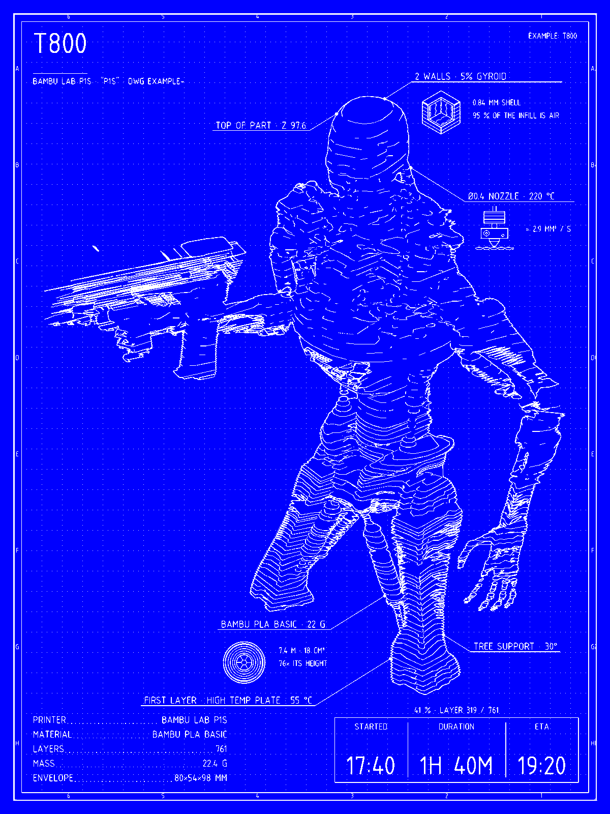
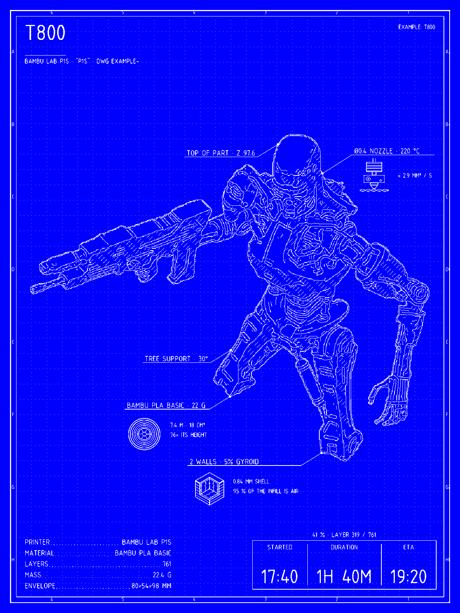
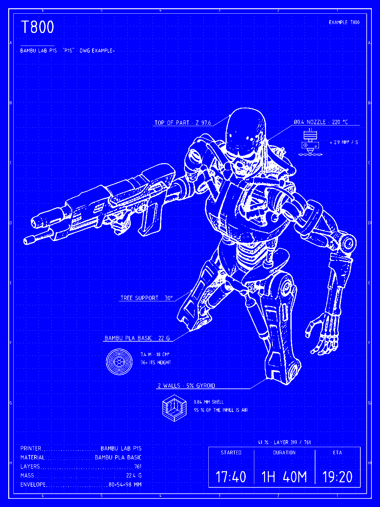
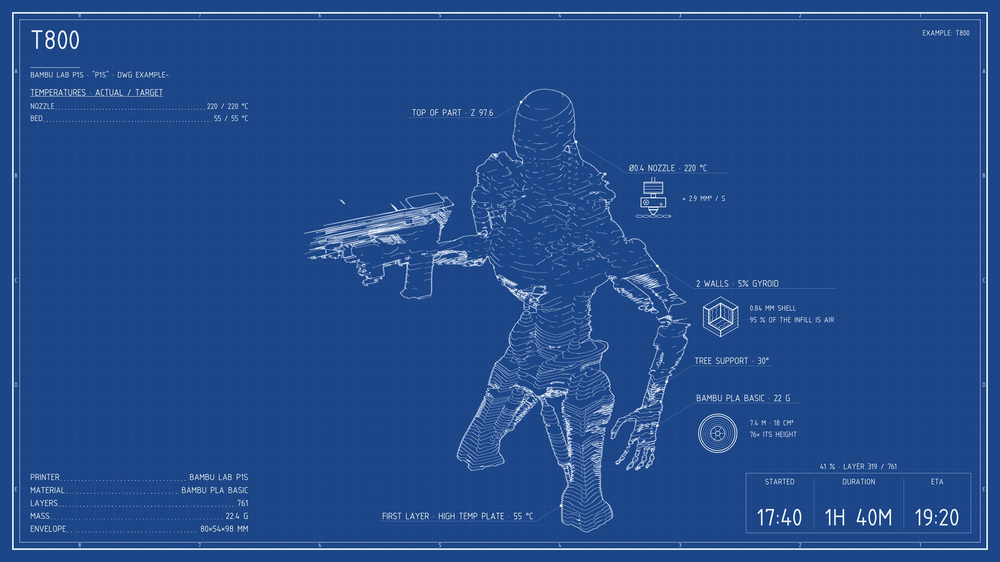

# Print Blueprint

A Tesserae widget that shows what a Bambu Lab printer is printing as an old-school technical drawing. The part sits in the middle of the sheet, drawn from its real toolpaths, and hairline callouts around it carry the live numbers from Home Assistant: the layer the nozzle is on, temperatures, material, walls and infill, start time and ETA. Paper comes in blueprint blue, white or black.



Every number on the sheet comes from Home Assistant or from the sliced file. When a value is unknown its line is left out.

## What you need

- Tesserae 0.484.1 or newer, with the Home Assistant Core widget connected to your Home Assistant.
- The [Bambu Lab integration (ha-bambulab)](https://github.com/greghesp/ha-bambulab) in Home Assistant. Any model works: A1 and A1 mini, P1P, P1S, P2S, X1, X1C, X1E, H2D, H2S, H2C, H3C. Any number of printers, with or without an AMS (AMS lite, AMS 2 Pro, AMS HT and several units are read too), single or dual nozzles, and tool changer racks.
- Optional: a [kie.ai](https://kie.ai) API key for the AI engraving picture.

## Install

Zip the `print_blueprint` folder and pick it with **Upload widget** on Widgets → Installed widgets, or copy the folder into Tesserae's `plugins/` (on the Home Assistant app, `/data/marketplace/print_blueprint/`). Restart Tesserae once afterwards: the widget's picture route and compare page are registered at start-up.

## Pick the printer

Add the widget to a page and choose the printer in its options. The list holds every `sensor.*_print_status` entity in Home Assistant, named by the printer's name. Leave it blank to show the first printer found. The widget reads every other value by the same prefix, so renamed entities in Home Assistant need the same prefix as their `print_status` sensor.

The sheet is drawn at the exact size of the cell, so the widget is meant to fill a page or a large cell.

## Picture methods

The **Picture** option picks how the part is drawn. The editor defaults to a bundled T800 example for that method, labelled "Example: T800". It works offline and follows the cell's size, paper, panel and drawing options.

Choose **Preview: Live print** to draw free toolpaths or line art for the current print. The chosen method's example stays up until its real sheet is ready, or when the printer is unavailable or idle. AI previews only use an engraving already made by a real screen render; previews never buy or collect AI tasks. This option only affects previews. Screens and pushes keep their normal behaviour.

The Picture thumbnails and their Enlarge view use the same example renderer. The canvas editor supplies the cell dimensions when its options drawer opens. Where the core supplies no dimensions, they use 1200 x 800. Reopen the drawer after changing the cell size or its options to refresh the thumbnails. To compare methods for the current print, open `/plugins/print_blueprint/compare` on your Tesserae server.

| Toolpaths | Line art from the preview | AI engraving |
| --- | --- | --- |
|  |  |  |

**Toolpaths** (the default) draws the outer walls from the G-code in the sliced 3MF, in isometric view. Printed layers are solid, the layers still to come are dashed, and a marker shows the nozzle's layer. Home Assistant only has the 3MF when ha-bambulab cached it (its print history). Cloud prints on printers without storage have no 3MF; the sheet then falls back to line art and says so in a small note at its top right.

**Line art from the preview** traces the slicer's cover picture that ha-bambulab publishes, with sharp contours and short shadow strokes that leave fine details clear. It is quick, free and works for every print. The integration drops that picture when it reloads during a print, so the widget keeps its own copy of each print's cover and uses that instead.

**AI engraving** sends the cover picture to kie.ai (`google/nano-banana-edit`) once per print and draws the answer as a pen-and-ink engraving. One picture costs about 4 kie.ai credits, roughly US$0.02, and took 15 to 20 seconds in our tests; line art shows until it arrives. The **AI pictures per day** setting caps submissions (12 by default). On cores with the shared artwork ledger, each submission also reserves two cents against the daily and monthly ceilings under Settings → Generative AI. The compare page never makes an AI picture; it shows one only if the widget already made it.

The widget saves a submission record before contacting kie.ai and keeps the task ID through timeouts, failed downloads and restarts. Later renders collect that task for free. Only a provider-reported failed task allows another automatic submission, after six hours. A missing or unreadable cover uses no allowance and starts no retry wait.

If a create response is lost, the widget cannot know whether kie.ai charged it. That print stays blocked; after 24 hours its submission is marked expired and still needs manual recovery. Stop Tesserae, check the task in your kie.ai account, then edit that print's entry under `tasks` in the widget data folder's `ai/state.json`: add its `id` to collect an existing task, or delete only that entry if you have confirmed no paid task exists. Restart Tesserae afterwards. Keep this state file when clearing cached images; it prevents repeat purchases. Older attempts whose IDs were discarded also need this check.

Drawing toolpaths takes from a few seconds to a few tens of seconds on a Raspberry Pi, so the widget does it in the background on screen refreshes, pushes and Live print previews. Until a print's first sheet exists the screen shows quick line art; after that, the previous sheet stays up while the next progress step is drawn. AI pictures are only made for screens, never for previews.

## Example

The bundled example comes from the print file "T800 - Finale plate 4",
[MakerWorld model 5846543](https://makerworld.com/en/models/5846543).
Its 3MF metadata lists the title as "T-800 Terminator", the designer as
"Mimmo72", and the license as "Standard Digital File License". The example
picture, toolpaths and AI engraving are derived from that file. These assets
retain the model's license; the widget's AGPL license does not cover them.

## Panels

The sheet is drawn for the panel it ends up on. With **Panel** on Auto (the default) the widget asks Tesserae which screen the render is for: Spectra 6 panels get two or three of the panel's colours (the paper, the ink and a red accent on white paper), 16-grey and 4-grey panels get their grey steps, black-and-white panels get hard black lines, and anything else gets full colour. You can pin a panel type in the option instead. Type, line weight and icons scale with the cell, so a 4K frame does not get tiny text.



On wide sheets the empty side space can hold sensor panels (temperatures, AMS slots, fans, machine hours) when the printer reports them and the part still has room. **Sensor panels** turns that off.

## Other options

- **Show progress**: off draws the finished part without the layer marker. The times block stays and is redrawn every 10 minutes while printing.
- **When idle**: *Show the last print* keeps the last sheet up ("PRINT COMPLETE" or "LAST PRINT"); *Show no print running* shows a short notice instead.
- **Refresh button cycles the background**: on by default. See below.
- Under More options: **Icons**, **Callout notes**, **Grid** and **Title line** (the printer line under the title).

## Refresh button

The widget adds a button action, `print_blueprint_cycle`. Each press moves that device's background white, blue, black, white, and repaints the panel in the same wake. The first press starts from the cell's own background. Map it under the device's Controls, Button map: `{"refresh": "print_blueprint_cycle"}` (or `"b"` for the physical key). Turn off *Refresh button cycles the background* in the cell options and the same mapping just redraws the frame with the latest sensor data.

The editor always previews the cell's own Paper. Once you save a different Paper, the next screen render drops the button's colour override. Each device's base and pressed colours live together in `paper.json`; the old `cycle.json`, `shown.json` and `edited.json` files are ignored.

## Show it only while printing

The widget has no switch of its own for this; Tesserae's lineups do it. Make a page with the widget for each printer, then a lineup for the screen in priority mode with one step per printer page. Give each step the condition that its printer is running:

```json
{"source_kind": "ha_entity", "source_id": "sensor.<prefix>_print_status", "operator": "==", "value": "running"}
```

Put this lineup above the screen's normal one (a high priority, a minimum hold of 0 minutes). While no printer runs, the screen goes back to its normal lineup at the next change, so a finished print stays up as PRINT COMPLETE until then. Tesserae treats a condition on an unknown entity as passing, so check the entity id with `POST /api/conditions/test` before relying on it.

## Settings

Under Settings → Widgets → Print Blueprint:

- **kie.ai API key**: only needed for AI engraving. Stored encrypted.
- **AI pictures per day**: at most this many AI pictures a day across all printers.

The widget declares `network:*` because your Home Assistant address is yours to choose; it also talks to kie.ai when AI engraving is on.

On disk it keeps the sliced files, cover pictures and AI pictures of the last 12 prints, and the 40 newest sheets.

## Tests

The renderer and widget tests use synthetic sliced files and a generated geometric cover.
Rebuild them with `python tests/make_fixtures.py`. Preview tests also use the
bundled T800 example described above.

Run the standalone tests:

```sh
uv run --python 3.12 --with pytest --with numpy --with pillow pytest tests -q
```

The Tesserae smoke tests run inside a Tesserae checkout. Copy (not symlink) `print_blueprint/` to the checkout's `plugins/`, then:

```sh
.venv/bin/python -m pytest plugins/print_blueprint/tests -q
```

## Credits

Lettering is [osifont](https://github.com/hikikomori82/osifont) by hikikomori82, ISO 3098 technical lettering, LGPL-3 with the GPL font exception; see `print_blueprint/fonts/LICENSE-osifont.md` and the licence texts beside it.

## Licence

Widget code: AGPL-3.0-only, see [LICENSE](LICENSE). The bundled example and
font retain their own licenses.
